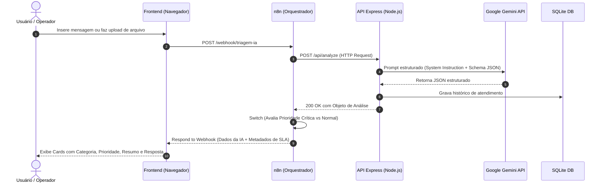

# 🤖 KODIE — Desafio Técnico: IA e Automação

> Solução inteligente para **Classificação, Resumo e Priorização de Mensagens e Atendimentos Corporativos** utilizando Inteligência Artificial (Google Gemini), Back-end (Node.js/Express), Automação (n8n) e persistência em banco de dados SQLite.

---

## 1. Apresentação da Ideia

Em empresas modernas, canais de comunicação (suporte, e-mails de clientes, formulários de contato e relatórios operacionais) recebem diariamente centenas de mensagens desestruturadas. Frequentemente, equipes perdem horas preciosas lendo cada texto para descobrir qual é o assunto, qual a urgência e para quem encaminhar.

A ideia deste projeto nasceu da necessidade de eliminar essa triagem manual repetitiva através de uma solução simples, robusta e direta: um sistema onde qualquer mensagem ou arquivo pode ser colado ou carregado, analisado instantaneamente por um modelo de linguagem avançado (LLM) e orquestrado por um fluxo de automação que define rotas e SLAs inteligentes.

---

## 2. Problema Escolhido

O projeto foca primariamente no **Cenário 4.1 (Classificação de Mensagens)**, combinando-o de forma sinérgica com o **Cenário 4.2 (Resumo Automático de Textos)** e o **Cenário 4.3 (Organização e Priorização de Tarefas)**:

* **Dor do Negócio:** Mensagens com diferentes níveis de gravidade (desde dúvidas corriqueiras até ameaças de cancelamento ou falhas críticas) caem na mesma fila sem distinção.
* **Impacto:** Demora no atendimento a chamados urgentes, sobrecarga humana na triagem e falta de histórico centralizado das solicitações recebidas.

---

## 3. Solução Proposta

Desenvolvemos uma aplicação integrada composta por:
1. **Interface Web Moderna (Frontend):** 
   - **Aba "Colar Mensagem":** Permite inserção rápida de textos com botões de testes pré-configurados (Cobrança indevida, Bug no sistema, Upgrade comercial).
   - **Aba "Upload de Arquivo":** Suporte a upload e extração de texto em tempo real de documentos `.txt`, `.md`, `.csv`, `.json` e `.pdf` (via PDF.js).
   - **Aba "Histórico (DB)":** Visualização das mensagens salvas no banco de dados SQLite.
   - **Aba "Configurações":** Permite alternar o roteamento (via Webhook n8n ou direto na API) e definir a chave da API do Gemini.
2. **Back-end em Node.js com Express:**
   - Endpoint `/api/analyze` responsável por orquestrar a chamada ao Google Gemini com engenharia de prompts rigorosa e validação de schema JSON.
   - Banco de dados SQLite embarcado (`node:sqlite`) para armazenamento e auditoria das mensagens triadas.
3. **Fluxo de Automação no n8n:**
   - Atua como orquestrador de eventos. Recebe o webhook, normaliza os dados, dispara a análise na API Express, aplica regras de negócio condicionais (Switch) baseadas no nível de prioridade (Crítica/Alta vs Padrão) e devolve a resposta estruturada ao cliente.

---

## 4. Tecnologias Utilizadas

| Camada | Tecnologia | Função |
|---|---|---|
| **Inteligência Artificial** | Google Gemini (`gemini-1.5-flash`) via `@google/generative-ai` | Classificação, sumarização executiva, sentimento e geração de resposta |
| **Back-end** | Node.js (v24) + Express | API RESTful com validação, CORS e persistência |
| **Banco de Dados** | SQLite Nativo (`node:sqlite`) | Armazenamento de histórico de requisições e auditoria |
| **Automação** | n8n | Orquestração de webhooks, roteamento condicional de prioridade e SLA |
| **Frontend** | HTML5, Tailwind CSS, Lucide Icons, PDF.js | Interface responsiva, limpa e moderna sem necessidade de build |
| **Contêineres** | Docker & Docker Compose (Opcional/Diferencial) | Execução unificada de API e n8n em containers |

---

## 5. Funcionamento do Sistema

### Fluxo de Dados:


### Formato da Resposta da IA (JSON Estruturado):
```json
{
  "categoria": "Reclamação",
  "prioridade": "Alta",
  "departamento": "Financeiro",
  "sentimento": "Negativo",
  "resumo": "Cliente contesta cobrança em duplicidade da assinatura premium e solicita estorno urgente.",
  "pontos_chave": [
    "Cobrança duplicada no valor de R$ 199,00",
    "Tentativa frustrada de contato anterior via telefone",
    "Ameaça de acionamento do Procon e cancelamento de conta"
  ],
  "acao_recomendada": "Abrir chamado financeiro com prioridade alta e efetuar conferência no gateway de pagamento para estorno.",
  "resposta_sugerida": "Olá! Lamentamos o transtorno com a cobrança em duplicidade. Nosso setor financeiro já foi acionado e estamos processando o estorno do valor de R$ 199,00. Em breve você receberá o comprovante."
}
```

---

## 6. Documentação do Fluxo de Automação (n8n)

O arquivo do fluxo encontra-se exportado em:  
📁 [`n8n/workflow_triagem_ia.json`](file:///n8n/workflow_triagem_ia.json)

### Estrutura dos Nós:
1. **Webhook de Entrada (`Webhook`):** Escuta requisições `POST` no caminho `/webhook/triagem-ia`.
2. **Normalizar Dados (`Edit Fields / Set`):** Extrai `text`, `source`, `filename` e `apiKey` do corpo da requisição.
3. **Chamar API Express (`HTTP Request`):** Envia o payload via `POST` para `http://localhost:3001/api/analyze`.
4. **Roteador por Prioridade (`Switch`):** Avalia se a prioridade retornada pela IA é `"Crítica"` ou `"Alta"` para rotear no canal urgente, ou encaminhar ao fluxo padrão.
5. **Definir SLA (`Set`):** Define metadados de atendimento (Ex: 30 minutos para chamados críticos, 4 horas para padrão).
6. **Responder ao Frontend (`Respond to Webhook`):** Retorna o resultado enriquecido para a interface web.

> 📸 **Observação para entrega:** As capturas de tela solicitadas no Item 7 do regulamento (fluxo completo conectado, execução com sucesso, configurações internas dos nós e dados processados) podem ser adicionadas na pasta `docs/prints/` ou anexadas junto ao envio final.

---

## 7. Como Executar o Projeto

### Pré-requisitos
* Node.js v20+ ou v24+
* Chave de API do Google Gemini ([obtenha gratuitamente no Google AI Studio](https://aistudio.google.com/))
* n8n rodando localmente, via Dokploy ou via Docker

---

### Opção A: Execução Local (Rápida)

#### 1. Configurar o Backend:
```bash
# Entre na pasta do backend
cd backend

# Instale as dependências
npm install

# Copie o arquivo de variáveis de ambiente e preencha sua GEMINI_API_KEY
cp .env.example .env
```

Edite o arquivo `.env`:
```env
PORT=3001
GEMINI_API_KEY=sua_chave_do_gemini_aqui
```

Inicie o servidor:
```bash
npm start
```
O servidor estará rodando em `http://localhost:3001`.

#### 2. Abrir o Frontend:
Como o backend serve os arquivos estáticos automaticamente, basta abrir seu navegador em:  
👉 **`http://localhost:3001`**  
*(Ou você pode abrir diretamente o arquivo `frontend/index.html` com o Live Server).*

#### 3. Importar o Fluxo no n8n:
1. Abra seu n8n.
2. Clique em **Workflows** > **Import from File...**
3. Selecione o arquivo `n8n/workflow_triagem_ia.json`.
4. Ative o fluxo (**Active**).

---

### Opção B: Execução com Docker & Docker Compose (Diferencial)

Para subir tanto a API quanto o n8n com um único comando:

1. Configure as variáveis no arquivo `.env` na raiz do projeto:
```bash
cp .env.example .env
```

2. Suba os contêineres:
```bash
docker compose up -d --build
```

3. Acesse os serviços:
- **Frontend / API:** `http://localhost:3001`
- **Painel n8n:** `http://localhost:5678`

---

## 8. Estrutura do Repositório

```text
├── backend/
│   ├── src/
│   │   ├── database.js          # Persistência SQLite local
│   │   ├── geminiService.js     # Integração com API Google Gemini
│   │   └── server.js            # Servidor Express & Rotas
│   ├── .env.example             # Modelo de variáveis de ambiente
│   ├── Dockerfile               # Imagem da aplicação backend
│   └── package.json
├── frontend/
│   ├── index.html               # Interface completa com Tailwind & Lucide
│   └── app.js                   # Lógica de upload, PDF parsing e comunicação
├── n8n/
│   └── workflow_triagem_ia.json # Fluxo exportado pronto para importação
├── docker-compose.yml           # Orquestração de containers da API + n8n
├── .env.example                 # Exemplo de configuração geral
├── .gitignore                   # Proteção de credenciais e arquivos temporários
└── README.md                    # Documentação detalhada
```

---

## 9. Conformidade com os Requisitos do Desafio

- [x] **API funcional:** Desenvolvida em Node.js com Express e rotas `/api/analyze` e `/api/history`.
- [x] **Integração com IA:** Google Gemini API utilizando engenharia de prompt estruturada.
- [x] **Resposta da IA estruturada:** Saída 100% em formato JSON com categorização, resumo e prioridade.
- [x] **Fluxo de automação:** Fluxo funcional no n8n com Webhook, HTTP Request, Switch condicional e Response.
- [x] **Persistência de Dados:** Histórico salvo em banco SQLite embutido.
- [x] **Interface funcional:** Suporte a inserção direta de texto e upload de múltiplos formatos (.txt, .pdf, etc.).
- [x] **Entrega com Docker:** Dockerfile e `docker-compose.yml` configurados como diferencial.
- [x] **Segurança:** Nenhuma credencial ou chave exposta no código (`.env.example` fornecido).

