# 🤖 KODIE — Desafio Técnico: IA e Automação

> **Solução Corporativa de Triagem Inteligente com IA e Automação:**  
> Classificação semântica (Cenário 4.1), Resumo executivo (Cenário 4.2) e Priorização com cálculo de SLA dinâmico (Cenário 4.3) integrando **Google Gemini**, **Node.js (Express)**, **SQLite nativo**, **n8n orquestrador** e **Deploy em Nuvem via Dokploy**.

[](#)
[-blue?style=flat-square)](https://desafio1.dmedia.com.br)
[](https://n8n.dmedia.com.br)
[](https://nodejs.org/)
[](https://aistudio.google.com/)
[](#)

---

## 🌐 Acesso Imediato aos Ambientes Online

* 🔗 **Aplicação em Produção (Frontend + API):** [https://desafio1.dmedia.com.br](https://desafio1.dmedia.com.br)
* ⚡ **Webhook n8n (Orquestrador em Produção):** `https://n8n.dmedia.com.br/webhook/e7561c7e-44bb-4dcf-8a43-a8adca53ae32`
* 🐙 **Repositório GitHub:** [https://github.com/Davisvasconcellos/kodie-desafio1](https://github.com/Davisvasconcellos/kodie-desafio1)

> 🔒 **O que fazer se o navegador acusar "Site Não Seguro" / Conexão Não Privada:**  
> Ao acessar o link em produção (`https://desafio1.dmedia.com.br`), caso o seu navegador exiba o aviso de segurança de certificado SSL (comum durante a propagação e renovação do Let's Encrypt pelo Dokploy), siga o procedimento padrão:  
> 1. Clique em **"Avançado"** (ou *"Mais detalhes"*).  
> 2. Clique em **"Ir para desafio1.dmedia.com.br (não seguro)"** para prosseguir.  
> A aplicação carregará normalmente sem nenhum risco à sua máquina.

> 🎓 **Disclaimer Educacional & Uso de Dados Fictícios:**  
> Esta solução foi desenvolvida com propósito **estritamente educacional, acadêmico e didático** como entrega do **Desafio Técnico KODIE (IA e Automação)**.  
> **Todos os dados apresentados, logs, documentos de teste, e-mails, nomes de clientes, empresas, CNPJs, CPFs e valores financeiros são 100% fictícios**, criados unicamente para validar as capacidades de processamento semântico, resumo e esteiras automatizadas da solução.

---

## 1. Apresentação da Ideia

Centrais de atendimento ao cliente, canais de suporte técnico e caixas de e-mail corporativas enfrentam diariamente um grande volume de mensagens desestruturadas. Em operações convencionais, operadores humanos precisam despender horas abrindo chamado por chamado para entender a gravidade, classificar o assunto e repassar ao departamento correto.

Este projeto soluciona o problema através de uma **esteira inteligente e automatizada de ponta a ponta**:
1. O usuário ou cliente submete uma mensagem em texto ou anexa um documento (relatório, extrato, PDF ou chamado).
2. O **n8n** intercepta a solicitação via Webhook, normaliza a carga útil e aciona a **API Express**.
3. A API aciona o **Google Gemini** com engenharia de prompts rigorosa, gerando categorização, sentimento, resumo executivo, pontos de atenção e sugestão de resposta.
4. O **n8n** avalia a gravidade, calcula o **SLA operacional** (ex.: 30 min para urgências financeiras/jurídicas vs. 4h para solicitações comuns) e entrega o retorno estruturado ao cliente, enquanto o **SQLite** registra a auditoria.

---

## 2. Problema Escolhido & Cenários Atendidos

O projeto contempla de forma sinérgica os três cenários propostos na especificação:

* **Cenário 4.1 (Classificação de Mensagens — Core do Desafio):** Identificação automática do tipo de mensagem (Dúvida, Reclamação, Suporte Técnico, Solicitação de Cancelamento, Contestação Financeira, Elogio) e direcionamento ao setor responsável (Financeiro, Suporte, Comercial, Jurídico, etc.).
* **Cenário 4.2 (Resumo Automático de Textos):** Síntese objetiva da mensagem em 2 a 3 linhas com extração dos principais pontos de atenção (bullet points claros).
* **Cenário 4.3 (Organização e Priorização de Tarefas):** Nível de urgência atribuído de forma semântica (Crítica, Alta, Média, Baixa) com definição imediata da ação recomendada e SLA operacional.

---

## 3. Solução Proposta e Funcionalidades

### 🖥️ Frontend Web Responsivo e Didático
* **Aba "Colar Mensagem":** Digitação livre com contador de caracteres e botões de preenchimento rápido de 1 clique (*Cobrança Duplicada*, *Falha no Sistema*, *Upgrade de Plano*).
* **Aba "Upload de Arquivo":** Suporte a arrastar e soltar (drag & drop) e seleção de arquivos `.txt`, `.md`, `.csv`, `.json` e `.pdf`.
  * **Limite de Upload de 500 KB:** Proteção contra sobrecarga de payload, com validação instantânea no navegador.
  * **Extração Client-Side de PDF:** Leitura nativa de PDFs diretamente no navegador via biblioteca **PDF.js**, sem necessidade de parsers pesados no servidor.
  * **📁 Pasta de Arquivos de Teste Prontos:** Disponibilizamos na pasta [`exemplos/`](exemplos/) um conjunto com **10 arquivos reais de demonstração** (chats, e-mails, relatórios, notificações e chamados de suporte) prontos para arrastar e soltar no upload!
* **Aba "Histórico (DB)":** Consulta em tempo real às triagens salvas no banco de dados SQLite, com busca e reabertura de análises anteriores.
* **Aba "Configurações":**
  * **Seletor de Rota Didático:** Alterna entre *Via n8n* e *Direto na API*.
  * **Diagnóstico de Webhook Integrado:** Botão para testar o webhook do n8n com medição de latência em milissegundos e exibição de status HTTP/resposta.
  * **Proteção Readonly (`ALLOW_CONFIG_EDITS`):** A URL do webhook e a chave da API ficam bloqueadas para edição em ambiente público, impedindo alterações indesejadas por outros usuários.
  * **Alternador de Tema:** Suporte completo a Modo Claro e Modo Escuro (Light/Dark Mode).

### ⚙️ Back-end em Node.js (Express)
* **`/api/analyze`:** Validação de payload, comunicação com Google Gemini com prompt estrito de sistema (System Instruction) e persistência em SQLite.
* **`/api/webhook-relay`:** Proxy intermediário seguro que elimina bloqueios de política de CORS do navegador ao dialogar com instâncias n8n.
* **`/api/config-status`:** Comunica dinamicamente ao frontend o estado das permissões de edição de configurações.
* **`/api/history` e `/health`:** Auditoria de dados gravados e monitoramento de integridade do serviço.

### 🔀 Orquestrador de Automação no n8n
* Webhook de entrada -> Normalização de dados -> Chamada à API Express -> Roteador condicional por prioridade (*Switch*) -> Definição de SLA operacional -> Resposta consolidada (*Respond to Webhook*).

---

## 4. Tecnologias Utilizadas

| Camada | Tecnologia | Papel na Arquitetura |
|---|---|---|
| **Inteligência Artificial** | Google Gemini (`gemini-flash-lite-latest` / `gemini-1.5-flash`) | Análise semântica, classificação de tópicos, sumarização e resposta sugerida |
| **Back-end** | Node.js (v24) + Express | API REST, CORS, proxy relay, validação de payload e roteamento |
| **Banco de Dados** | SQLite Nativo (`node:sqlite`) | Persistência local do histórico de auditoria e triagens |
| **Automação** | n8n (Self-hosted Dokploy) | Orquestração de eventos, regras de negócio, branch condicional e SLAs |
| **Frontend** | HTML5, Tailwind CSS, Lucide Icons, PDF.js | Interface moderna, responsiva e rica sem necessidade de build complexo |
| **Deploy & Nuvem** | Docker & Dokploy (Cloud) | Execução em contêiner único unificado com SSL automático (Let's Encrypt) |

---

## 5. Arquitetura e Roteamento Didático

### Diagrama de Sequência da Esteira Completa:
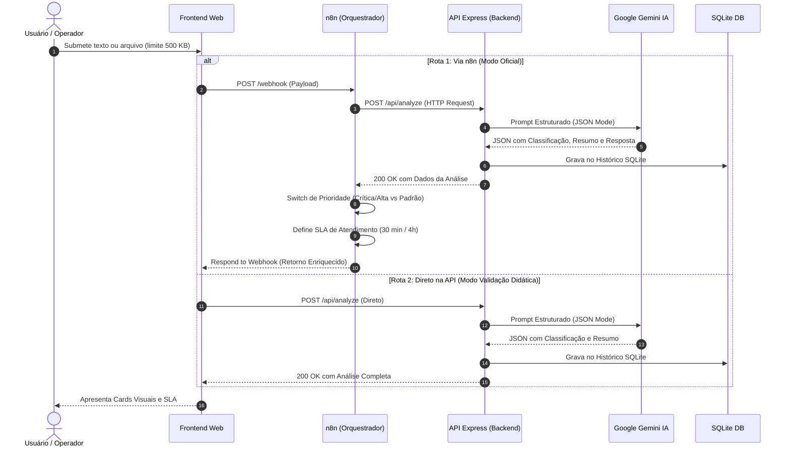

### Explicação dos Modos de Roteamento (Aba Configurações):
1. **Modo "Via n8n (Oficial / Orquestrador)":**  
   Dispara a esteira completa no n8n. Este é o fluxo oficial de produção exigido no desafio, demonstrando a integração ponta a ponta: Webhook -> Normalização -> Chamada HTTP à API -> Roteamento Condicional de Prioridade -> Cálculo de SLA -> Resposta ao Webhook.
2. **Modo "Direto na API (Validação Didática)":**  
   Opção criada com propósito **estritamente didático**, permitindo que avaliadores, colegas de curso ou usuários finais testem e validem o funcionamento da LLM (Google Gemini), os prompts de sumarização/categorização e o banco SQLite de forma imediata, **caso não possuam uma instância do n8n instalada ou rodando localmente**.

---

## 6. Documentação dos Arquivos do n8n

Para fins de transparência técnica e facilidade didática, a pasta [`n8n/`](n8n/) disponibiliza as seguintes versões do fluxo:

1. 📄 **[`n8n/01-workflow-para-importar.json`](n8n/01-workflow-para-importar.json) — Template Pronto para Importação:**  
   Arquivo formatado e limpo, ideal para qualquer pessoa importar diretamente em uma instância n8n nova (*Menu Workflows > Import from File*). Contém anotações visuais (Sticky Notes) explicativas.
2. 📄 **[`n8n/02-workflow-exportado-producao.json`](n8n/02-workflow-exportado-producao.json) — Cópia Bruta de Produção:**  
   Exportação literal direta da nossa instância de produção no Dokploy (`https://n8n.dmedia.com.br`), contendo os metadados reais de execução e IDs da esteira ativa.
3. 📄 **[`n8n/workflow_triagem_ia.json`](n8n/workflow_triagem_ia.json):**  
   Arquivo espelho mantido para compatibilidade com o `docker-compose.yml`.

### Como Configurar a URL da API no nó "Chamar API Express (Gemini)":
* **Ambiente em Produção (Dokploy / Nuvem):**  
  Configure o campo **URL** do nó HTTP Request para:  
  `https://desafio1.dmedia.com.br/api/analyze`  
  *(Ative a opção "Ignore SSL Issues" / `allowUnauthorizedCerts: true` para tolerar variações de certificado SSL).*
* **Ambiente Local (Localhost):**  
  Se o n8n e o Backend estiverem rodando na mesma máquina:  
  `http://localhost:3001/api/analyze` (ou `http://backend:3001/api/analyze` caso use Docker Compose).  
  *Nota: Caso utilize o n8n na nuvem e o Backend no seu computador, utilize um túnel (ex.: Cloudflare Tunnel ou ngrok) para permitir que o n8n alcance seu localhost.*

---

## 7. Documentação Visual da Automação (Prints do n8n)

Abaixo estão as capturas de tela comprovando a implementação detalhada de cada etapa da automação, armazenadas em [`docs/prints/`](docs/prints/):

### 1. Visão Geral do Fluxo Completo
Todos os nós conectados e estruturados com documentação visual (Sticky Note):
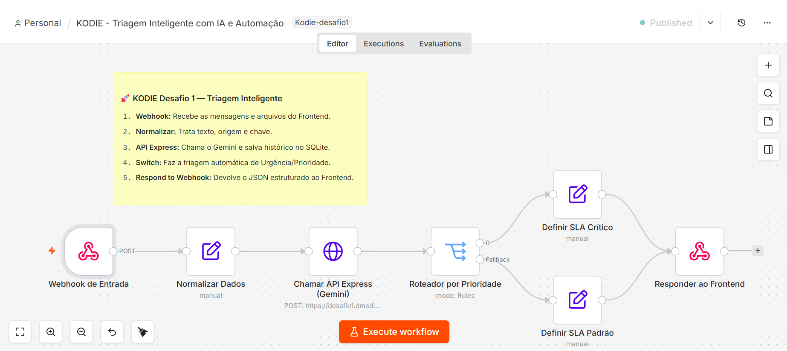

---

### 2. Execução Concluída com Sucesso
Demonstração do fluxo executado com status verde em todas as etapas:
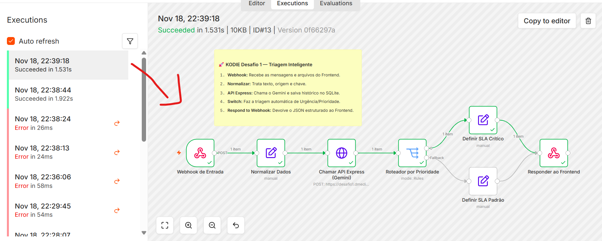

---

### 3. Configuração do Nó de Webhook
Webhook configurado para receber requisições HTTP `POST` e responder via nó específico:
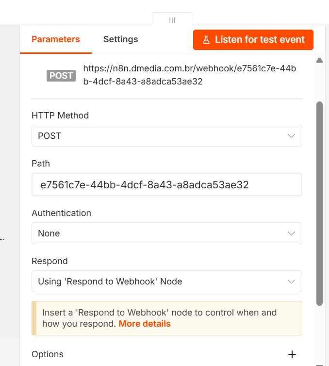

---

### 4. Configuração do Nó Normalizar Dados (Edit Fields)
Extração e sanitização dos campos de entrada (`text`, `source`, `filename`, `apiKey`):
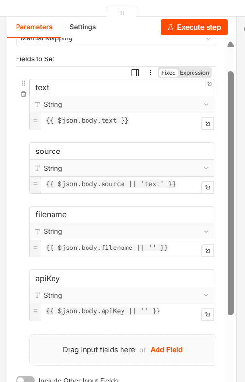

---

### 5. Configuração do Nó HTTP Request (Chamar API Gemini)
Disparo do payload para a API Express com tratamento de cabeçalhos e tolerância SSL:
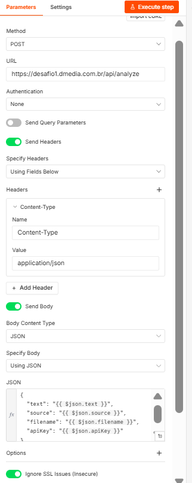

---

### 6. Configuração do Roteador por Prioridade (Switch)
Regras condicionais direcionando prioridades "Crítica" e "Alta" para a esteira urgente:
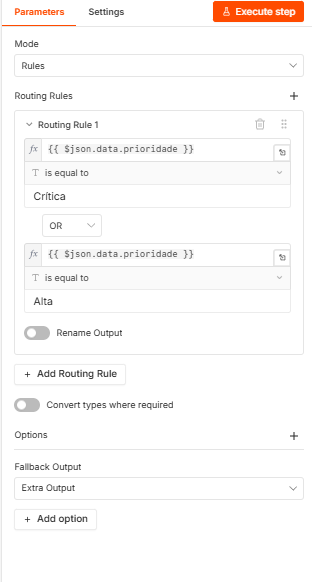

---

### 7. Configuração dos Nós de SLA Operacional
Definição de SLA de 30 minutos com alerta ao supervisor para demandas críticas, e 4 horas para demandas normais:
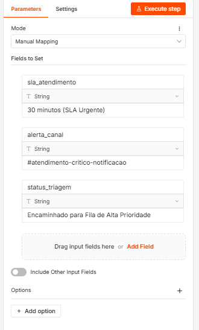
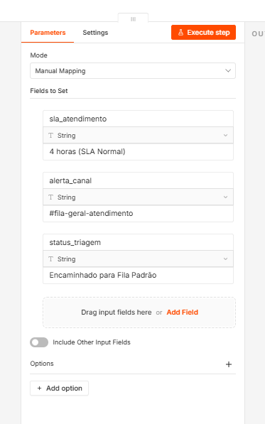

---

### 8. Configuração do Nó Respond to Webhook
Consolidação do retorno estruturado para o frontend:
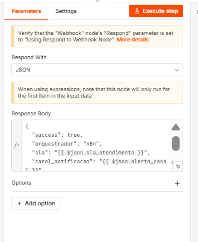

---

### 9. Dados Processados na Execução
Inspeção visual dos dados recebidos e transformados ao final do fluxo:
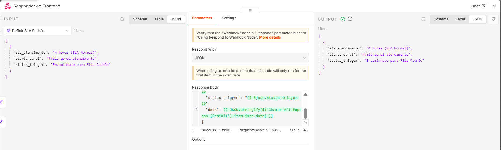

---

## 8. Segurança e Bloqueio de Configurações (`ALLOW_CONFIG_EDITS`)

Para garantir a estabilidade do ambiente compartilhado em produção e evitar que visitantes ou outros alunos alterem acidentalmente a URL do Webhook ou apaguem as credenciais da IA, o sistema conta com a flag de proteção:

```env
ALLOW_CONFIG_EDITS=false
```

* **Com `ALLOW_CONFIG_EDITS=false` (Padrão):**  
  Os campos de Chave de API do Gemini e URL do Webhook n8n tornam-se `readonly` (somente leitura) no navegador. O frontend exibe um banner indicando que as credenciais são gerenciadas com segurança pelo servidor.
* **Como liberar a edição (ao clonar o projeto):**  
  Se você clonou o repositório e deseja testar seus próprios webhooks e chaves diretamente pela interface, altere no arquivo `.env`:
  ```env
  ALLOW_CONFIG_EDITS=true
  ```
  Ao reiniciar o servidor (`npm start` ou deploy no Dokploy), os campos ficarão livres para digitação e salvamento no navegador.

---

## 9. Como Executar o Projeto Localmente

### Pré-requisitos
* Node.js v20+ ou v24+
* Chave de API do Google Gemini ([obtenha gratuitamente no Google AI Studio](https://aistudio.google.com/))
* Git

### Passo a Passo

1. **Clonar o Repositório:**
   ```bash
   git clone https://github.com/Davisvasconcellos/kodie-desafio1.git
   cd kodie-desafio1
   ```

2. **Configurar as Variáveis de Ambiente:**
   ```bash
   cp .env.example .env
   cp backend/.env.example backend/.env
   ```
   Abra `backend/.env` e defina suas chaves:
   ```env
   PORT=3001
   GEMINI_API_KEY=sua_chave_do_gemini
   ALLOW_CONFIG_EDITS=true
   ```

3. **Instalar Dependências e Iniciar o Servidor:**
   ```bash
   cd backend
   npm install
   npm start
   ```

4. **Acessar a Aplicação:**
   Abra seu navegador em:  
   👉 **`http://localhost:3001`**

---

## 10. Estrutura do Repositório

```text
DESAFIO-1/
├── backend/
│   ├── public/                             # Cópia compilada do frontend servida pelo Express
│   │   ├── index.html
│   │   └── app.js
│   ├── src/
│   │   ├── database.js                     # Persistência SQLite nativa
│   │   ├── geminiService.js                # Integração com Gemini e fallbacks
│   │   └── server.js                       # Servidor Express, rotas e Webhook Relay
│   ├── .env.example
│   ├── Dockerfile                          # Build do backend
│   └── package.json
├── frontend/
│   ├── index.html                          # UI com Tailwind, Lucide Icons e PDF.js
│   └── app.js                              # Lógica de upload (500k), modo readonly e testes
├── exemplos/                               # 10 Arquivos de exemplo para teste de upload
│   ├── 01-email-cobranca-duplicada.txt
│   ├── 02-chamado-falha-critica-sistema.txt
│   ├── 03-proposta-expansao-comercial.txt
│   ├── 04-suporte-integracao-api.md
│   ├── 05-notificacao-cancelamento-contrato.txt
│   ├── 06-transcricao-chat-ao-vivo.txt
│   ├── 07-relatorio-feedbacks-clientes.csv
│   ├── 08-alerta-seguranca-acesso-suspeito.md
│   ├── 09-elogio-reconhecimento-suporte.txt
│   ├── 10-webhook-estorno-gateway.json
│   └── README.md                           # Catálogo didático dos cenários de teste
├── n8n/
│   ├── 01-workflow-para-importar.json       # Template didático para importar em nova instância
│   ├── 02-workflow-exportado-producao.json  # Cópia bruta da instância ativa Dokploy
│   ├── workflow_triagem_ia.json            # Espelho para Docker Compose
│   └── README.md                           # Instruções específicas do n8n
├── docs/
│   └── prints/                             # Capturas de tela comprobatórias da automação
│       ├── 01-fluxo-completo.png
│       ├── 02-execucao-sucesso.png
│       ├── 03-config-webhook.png
│       ├── 04-config-normalizar.png
│       ├── 05-config-http-request.png
│       ├── 06-config-switch.png
│       ├── 07-config-sla1.png
│       ├── 07-config-sla2.png
│       ├── 08-config-respond.png
│       └── 09-resultado-execucao.png
├── docker-compose.yml                      # Subida conjunta da API e n8n local (Diferencial)
├── Dockerfile                              # Dockerfile unificado na raiz para Dokploy
├── .env.example
├── .gitignore
└── README.md                               # Documentação técnica completa
```

---

## 11. Checklist de Conformidade com o Regulamento KODIE

- [x] **API Funcional:** Desenvolvida em Node.js com Express e endpoints `/health`, `/api/analyze`, `/api/config-status` e `/api/history`.
- [x] **Integração com IA:** Google Gemini com engenharia de prompts avançada e fallback resiliente.
- [x] **Resposta Estruturada:** Saída estrita em formato JSON com categoria, prioridade, resumo, pontos-chave e resposta sugerida.
- [x] **Fluxo n8n Completo:** Webhook, Edit Fields, HTTP Request, Switch de prioridade e Respond to Webhook.
- [x] **Persistência de Dados:** Histórico salvo automaticamente em banco de dados SQLite.
- [x] **Interface Funcional:** Suporte a texto direto, upload com limite de 500 KB e leitura client-side de PDFs.
- [x] **Entrega com Docker:** Dockerfile e `docker-compose.yml` funcionais (Diferencial atendido).
- [x] **Deploy em Nuvem:** Sistema em produção rodando no Dokploy com HTTPS ativo.
- [x] **Segurança e Boas Práticas:** Nenhuma credencial exposta e proteção `ALLOW_CONFIG_EDITS` implementada.
