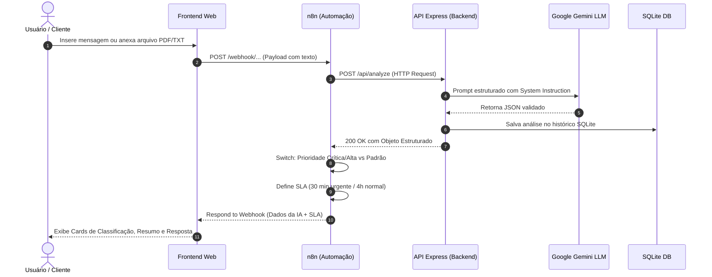

# 🤖 KODIE — Desafio Técnico: IA e Automação

> Solução completa para **Classificação, Resumo e Priorização de Mensagens e Atendimentos Corporativos** integrando Inteligência Artificial (Google Gemini), Back-end (Node.js/Express), Automação de Processos (n8n), persistência SQLite e deploy em nuvem via Dokploy.

[](#)
[-blue?style=flat-square)](https://desafio1.dmedia.com.br)
[](https://n8n.dmedia.com.br)
[](https://nodejs.org/)
[](https://aistudio.google.com/)

---

## 🌐 Acesso Rápido aos Ambientes Online

* **Aplicação em Produção (Frontend + API):** [https://desafio1.dmedia.com.br](https://desafio1.dmedia.com.br)
* **Webhook do n8n (Orquestrador):** `https://n8n.dmedia.com.br/webhook/e7561c7e-44bb-4dcf-8a43-a8adca53ae32`
* **Repositório GitHub:** [https://github.com/Davisvasconcellos/kodie-desafio1](https://github.com/Davisvasconcellos/kodie-desafio1)

---

## 1. Apresentação da Ideia

Em empresas modernas, centrais de relacionamento, caixas de e-mail de suporte e formulários de atendimento recebem diariamente centenas de demandas desestruturadas. Muitas vezes, uma equipe inteira é alocada apenas para ler mensagens manualmente, identificar a urgência e repassar para o departamento adequado.

A proposta deste projeto é transformar esse gargalo operacional em uma **esteira automatizada e inteligente**:
O cliente ou operador envia uma mensagem ou faz upload de um relatório/documento. O fluxo de automação no **n8n** captura o evento, aciona a **API Express** que utiliza o **Google Gemini** sob engenharia de prompt estruturada, classifica o chamado, extrai os pontos-chave, resume o conteúdo, define a prioridade e retorna uma sugestão de resposta imediata com SLA específico.

---

## 2. Problema Escolhido

O projeto atende prioritariamente ao **Cenário 4.1 (Classificação de Mensagens)**, integrando simultaneamente os benefícios do **Cenário 4.2 (Resumo Automático de Textos)** e do **Cenário 4.3 (Organização e Priorização de Tarefas)**:

* **O Cenário:** Uma empresa recebe mensagens com diferentes naturezas (dúvidas comerciais, reclamações graves, falhas técnicas, contestações financeiras e elogios).
* **O Gargalo:** Sem uma triagem imediata, solicitações críticas (ex: cobranças indevidas ou ameaças de cancelamento/processo) ficam retidas na mesma fila que dúvidas rotineiras.
* **A Resolução:** A IA categoriza, calcula o nível de prioridade (Baixa, Média, Alta ou Crítica), determina o setor de destino e o n8n estabelece o SLA de resposta automaticamente.

---

## 3. Solução Proposta

A solução é composta por 4 pilares totalmente integrados:

1. **Frontend Moderno e Responsivo:**
   - **Aba "Colar Mensagem":** Campo para colagem direta de mensagens com exemplos de teste de 1 clique (*Cobrança Duplicada*, *Bug no Sistema*, *Upgrade Comercial*).
   - **Aba "Upload de Arquivo":** Suporte a arrastar e soltar arquivos `.txt`, `.md`, `.csv`, `.json` e leitura de arquivos `.pdf` diretamente no navegador via **PDF.js**.
   - **Aba "Histórico (DB)":** Exibição das triagens registradas no banco de dados local com clique para reabertura de resultados.
   - **Aba "Configurações":** Ferramenta com **Modo de Teste de Diagnóstico de Webhook** em tempo real (mede latência e status HTTP), seletor de rota (*Via n8n* ou *Direto na API*) e alternador de **Modo Claro / Escuro (Light & Dark Mode)**.

2. **Back-end em Node.js com Express:**
   - Endpoint `/api/analyze` que valida o texto recebido, chama o modelo Gemini com prompt de sistema rigoroso e saída estrita em JSON.
   - Endpoint `/api/webhook-relay` que atua como proxy seguro para eliminar problemas de CORS no navegador durante a comunicação com o n8n.
   - Banco de dados SQLite embarcado (`node:sqlite`) que grava o histórico de atendimentos sem necessidade de bancos externos pesados.

3. **Orquestrador de Automação no n8n:**
   - Fluxo completo com Webhook de entrada, nó de normalização de dados, HTTP Request com a API, roteamento condicional de prioridade (*Switch*) e enriquecimento de SLA.

4. **Deploy Unificado em Nuvem (Dokploy):**
   - O contêiner Docker foi otimizado para que a mesma aplicação sirva o Frontend estático na raiz (`/`) e a API REST em (`/api/analyze`), garantindo alta performance e zero configuração extra.

---

## 4. Tecnologias Utilizadas

| Camada | Tecnologia | Finalidade |
|---|---|---|
| **Inteligência Artificial** | Google Gemini (`gemini-flash-lite-latest` / `gemini-1.5-flash`) | Análise semântica, categorização, sumarização e sugestão de resposta |
| **Back-end** | Node.js (v24) + Express | API REST, CORS, roteamento, validação e relay de requisições |
| **Banco de Dados** | SQLite Nativo (`node:sqlite` do Node 24) | Armazenamento local do histórico de auditoria e análises |
| **Automação** | n8n (Self-hosted no Dokploy) | Orquestração de eventos, roteamento condicional de prioridade e SLA |
| **Frontend** | HTML5, Tailwind CSS (CDN), Lucide Icons, PDF.js | Interface responsiva, limpa e moderna sem necessidade de etapa de build |
| **Infraestrutura** | Docker & Dokploy (Cloud) | Execução em contêineres com certificado SSL automático via Let's Encrypt |

---

## 5. Funcionamento do Sistema

### Diagrama de Sequência da Arquitetura:


### Formato Obrigatório da Saída da IA (JSON Estruturado):
```json
{
  "categoria": "Financeiro",
  "prioridade": "Crítica",
  "departamento": "Financeiro",
  "sentimento": "Urgente",
  "resumo": "Cliente contesta cobrança em duplicidade na fatura da assinatura premium no valor de R$ 199,00, exigindo estorno urgente sob ameaça de cancelamento e acionamento do Procon.",
  "pontos_chave": [
    "Cobrança em duplicidade na fatura atual",
    "Valor contestado de R$ 199,00",
    "Tentativa de contato anterior por telefone sem retorno",
    "Ameaça de cancelamento de serviço e notificação ao Procon"
  ],
  "acao_recomendada": "Verificar imediatamente o gateway de pagamento, estornar o valor cobrado indevidamente e retornar contato para evitar acionamento judicial.",
  "resposta_sugerida": "Olá! Pedimos sinceras desculpas pelo transtorno com a cobrança duplicada. Já identificamos o ocorrido e estamos processando o estorno imediato do valor de R$ 199,00. Em breve enviaremos o comprovante."
}
```

---

## 6. Documentação do Fluxo de Automação (n8n)

Os arquivos do fluxo exportados encontram-se na pasta `n8n/`:
* 📁 [`n8n/KODIE - Triagem Inteligente com IA e Automação.json`](file:///n8n/KODIE%20-%20Triagem%20Inteligente%20com%20IA%20e%20Automação.json)
* 📁 [`n8n/workflow_triagem_ia.json`](file:///n8n/workflow_triagem_ia.json)

### Detalhamento dos Nós do Fluxo:

1. **Webhook de Entrada (`Webhook`):**  
   Configurado para método `POST` no caminho registrado do n8n com modo de resposta `Using 'Respond to Webhook' Node`.
2. **Normalizar Dados (`Edit Fields / Set`):**  
   Extrai com segurança `body.text`, `body.source`, `body.filename` e `body.apiKey`.
3. **Chamar API Express (Gemini) (`HTTP Request`):**  
   Dispara um `POST` para `https://desafio1.dmedia.com.br/api/analyze` enviando o payload JSON e com a opção `allowUnauthorizedCerts: true` para tolerância de SSL.
4. **Roteador por Prioridade (`Switch`):**  
   Avalia a propriedade `{{ $json.data.prioridade }}`:
   - **Saída 0:** Se for `"Crítica"` ou `"Alta"`.
   - **Saída 1 (Fallback):** Se for `"Média"`, `"Baixa"` ou qualquer outra.
5. **Definir SLA Crítico / Padrão (`Set`):**  
   Atribui metas operacionais dinâmicas (`sla_atendimento: "30 minutos"` ou `"4 horas"`) e canal de encaminhamento.
6. **Responder ao Frontend (`Respond to Webhook`):**  
   Devolve os dados consolidados da IA juntamente com os metadados de automação do n8n para a interface do usuário.

---

## 7. Documentação Visual da Automação (Prints)

As capturas de tela comprovando a implementação, configuração interna dos nós e execuções bem-sucedidas estão organizadas na pasta [`docs/prints/`](docs/prints/):

| Item Avaliado | Descrição | Arquivo |
|---|---|---|
| **1. Fluxo Completo** | Visão geral de todos os nós conectados no canvas | `docs/prints/01-fluxo-completo.png` |
| **2. Execução Bem-Sucedida** | Print do fluxo executado com status verde | `docs/prints/02-execucao-sucesso.png` |
| **3. Configuração do Webhook** | Configuração interna do nó Webhook (POST e Response Mode) | `docs/prints/03-config-webhook.png` |
| **4. Configuração Normalizar** | Configuração do nó Set (Edit Fields) | `docs/prints/04-config-normalizar.png` |
| **5. Configuração HTTP Request** | Detalhes da chamada à API Express (`/api/analyze`) | `docs/prints/05-config-http-request.png` |
| **6. Configuração Switch** | Regras de classificação por prioridade (Crítica vs Normal) | `docs/prints/06-config-switch.png` |
| **7. Configuração SLA** | Nós de definição de SLA e canal de roteamento | `docs/prints/07-config-sla.png` |
| **8. Configuração Respond** | Nó Respond to Webhook e montagem do payload | `docs/prints/08-config-respond.png` |
| **9. Dados Processados** | Print dos dados recebidos e processados na saída | `docs/prints/09-resultado-execucao.png` |

---

## 8. Como Executar o Projeto

### Pré-requisitos
* Node.js v20+ ou v24+
* Chave de API do Google Gemini ([obtenha gratuitamente no Google AI Studio](https://aistudio.google.com/))
* Git instalado

---

### Opção A: Execução em Nuvem (Dokploy) — Recomendada
A aplicação já se encontra configurada para build automático em contêiner único:
1. No painel do Dokploy, conecte seu repositório GitHub.
2. Defina o **Dockerfile:** `Dockerfile` e **Context:** `.`.
3. Preencha a porta: `3001`.
4. Na aba **Environment**, insira:
   ```env
   PORT=3001
   GEMINI_API_KEY=sua_chave_gemini_aqui
   GEMINI_MODEL=gemini-flash-lite-latest
   ```
5. Defina o domínio e acesse imediatamente pelo navegador.

---

### Opção B: Execução Local

1. **Clonar o Repositório:**
   ```bash
   git clone https://github.com/Davisvasconcellos/kodie-desafio1.git
   cd kodie-desafio1
   ```

2. **Configurar as Variáveis de Ambiente:**
   ```bash
   cp .env.example .env
   cp backend/.env.example backend/.env
   ```
   *Abra o arquivo `backend/.env` e insira sua `GEMINI_API_KEY`.*

3. **Instalar Dependências e Iniciar o Servidor:**
   ```bash
   cd backend
   npm install
   npm start
   ```

4. **Acessar a Aplicação:**
   Abra no navegador:  
   👉 **`http://localhost:3001`**

---

### Opção C: Execução com Docker & Docker Compose (Diferencial)

Para subir o ambiente completo (API Backend + n8n local) em contêineres:

1. Configure as variáveis no arquivo `.env` na raiz:
   ```bash
   cp .env.example .env
   ```
2. Execute o comando:
   ```bash
   docker compose up -d --build
   ```
3. Acesse os serviços:
   - **Aplicação Completa:** `http://localhost:3001`
   - **Painel n8n:** `http://localhost:5678`

---

## 9. Estrutura do Repositório

```text
DESAFIO-1/
├── backend/
│   ├── public/                  # Cópia compilada do frontend para deploy único
│   ├── src/
│   │   ├── database.js          # Persistência SQLite local
│   │   ├── geminiService.js     # Integração com Google Gemini (com fallback dinâmico)
│   │   └── server.js            # Servidor Express, rotas e Webhook Relay
│   ├── .env.example             # Variáveis de ambiente de exemplo
│   ├── Dockerfile               # Dockerfile do backend
│   └── package.json             # Dependências Node.js
├── frontend/
│   ├── index.html               # Interface com abas, Tailwind CSS, Lucide e PDF.js
│   └── app.js                   # Lógica de upload, leitura de PDF, tema e conexão
├── n8n/
│   ├── KODIE - Triagem...json   # Export do fluxo direto da instância n8n
│   └── workflow_triagem_ia.json # Versão sincronizada do fluxo para importação
├── docs/
│   └── prints/                  # Pasta para os prints comprobatórios do n8n
├── docker-compose.yml           # Orquestração da API + n8n (Diferencial)
├── Dockerfile                   # Dockerfile unificado na raiz para Dokploy
├── .env.example                 # Exemplo de configuração geral
├── .gitignore                   # Proteção contra vazamento de credenciais e bancos locais
└── README.md                    # Documentação técnica completa
```

---

## 10. Checklist de Conformidade com o Regulamento KODIE

- [x] **API Funcional:** Desenvolvida em Node.js com Express e endpoints `/health`, `/api/analyze` e `/api/history`.
- [x] **Integração com IA:** Google Gemini com engenharia de prompts avançada e fallback resiliente.
- [x] **Resposta Estruturada:** Saída estrita em formato JSON com categoria, prioridade, resumo, pontos-chave e resposta sugerida.
- [x] **Fluxo n8n Completo:** Webhook, Edit Fields, HTTP Request, Switch de prioridade e Respond to Webhook.
- [x] **Persistência de Dados:** Histórico salvo automaticamente em banco de dados SQLite.
- [x] **Interface Funcional:** Suporte a texto direto, upload de arquivos e leitura client-side de PDFs.
- [x] **Entrega com Docker:** Dockerfile e `docker-compose.yml` funcionais (Diferencial atendido).
- [x] **Deploy em Nuvem:** Sistema em produção rodando no Dokploy com HTTPS ativo.
- [x] **Segurança e Boas Práticas:** Nenhuma credencial ou token exposto no código-fonte.
